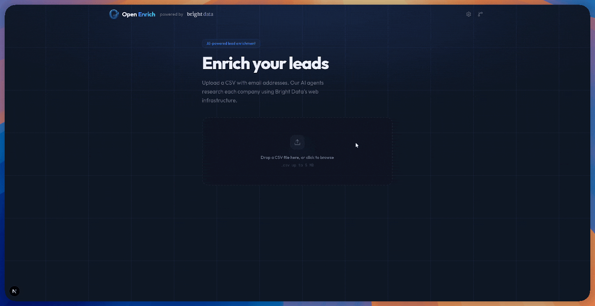
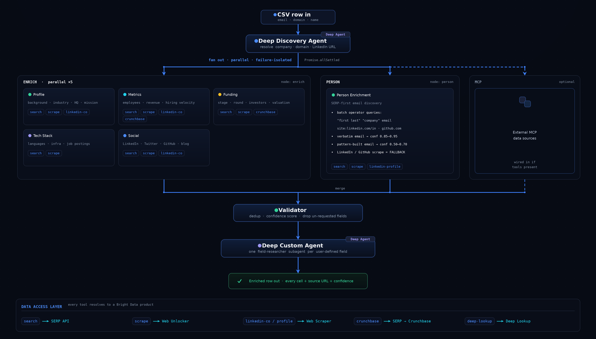

<div align="center">


# Open Enrich

<strong>面向市场拓展团队的开源数据丰富引擎。</strong>基于 Bright Data 网络基础设施构建的 LangGraph 智能体集群。导入 CSV，即可获得公司情报、联系人信息和购买信号，每个单元格都附有引用来源。

<br />

[](./LICENSE) [](https://nodejs.org) [](https://nextjs.org) [](https://langchain-ai.github.io/langgraphjs/) [](https://www.bright.cn/) [](https://skills.sh/brightdata/open-enrich)

<br />

<a href="https://www.bright.cn/">
  <picture>
    <source media="(prefers-color-scheme: dark)" srcset="./docs/assets/brightdata-logo.png" />
    
  </picture>
</a>

</div>

<br />

<!-- ─────────────────────────────────────────────────────────────────────── -->

<div align="center">

> ### **▶ 演示**



</div>

<br />

<!-- ─────────────────────────────────────────────────────────────────────── -->

## 为什么要做这个项目

商业数据丰富工具每行收费 0.50 至 2.00 美元，通过合同限制数据访问，而且很少告诉你某个字段的*来源*。通用抓取工具价格低廉，但只提供原始 HTML：你仍需自行构建智能体、提取逻辑、置信度评分和 CRM 映射。

Open Enrich 正是二者之间缺失的中间层。网络就是数据集，Bright Data 是访问层，LangGraph 是编排器，输出则是你的 SDR 可以在周一上午 9 点直接粘贴到 Salesforce 或 HubSpot 的 CSV。

| | 商业数据丰富工具 | 通用爬虫工具 | **Open Enrich** |
|---|---|---|---|
| **每行成本** | 0.50 至 2.00 美元 | 较低，但一切都要自行构建 | API 调用费用约为 0.01 至 0.05 美元 |
| **来源归属** | 很少提供 | 无 | 每个单元格均提供 URL + 摘录 |
| **LinkedIn / Crunchbase** | 支持（需签约） | 受阻或不可靠 | 支持（Bright Data 结构化抓取工具） |
| **个人电子邮件** | 支持（受限） | 不支持 | 支持（SERP 模式发现 + LinkedIn 回退） |
| **可自行托管** | 不支持 | 支持 | 支持 |
| **CRM 格式导出** | 支持 | 不支持 | 支持（Salesforce + HubSpot 映射） |

<br />

<!-- ─────────────────────────────────────────────────────────────────────── -->

## 工作原理

一行 CSV 数据会转换为一次有状态的 LangGraph 运行。首先执行发现，然后由专业智能体并行展开处理，最后由验证器合并结果。



每个智能体都是一个带有结构化 Zod 输出的类型化 LangChain `tool()` 图。工具封装了 Bright Data 的搜索引擎 API、网络解锁器、LinkedIn / Crunchbase 爬虫工具和 Deep Lookup。故障按智能体隔离，因此单次抓取失败绝不会导致整行处理终止。

<br />

<!-- ─────────────────────────────────────────────────────────────────────── -->

## 可提取的内容

**ICP 资格评估**：员工人数、营收、行业、总部、公司类型、融资阶段 **购买信号**，近期融资、招聘速度、领导层变动、招聘职位、技术变更 **个性化切入点**，公司使命、近期新闻、博客主题、会议活动 **联系数据**，工作邮箱（SERP 模式 + 验证）、电话、LinkedIn、GitHub、Twitter、职位、资历、所在地 **社交 / 网络信息**，LinkedIn URL、Twitter、GitHub 组织、公司博客、招聘页面 **自定义字段**，用自然语言描述你想要的内容，智能体会完成研究

内置置信度评分。由三个独立来源相互印证的字段得分为 0.95；基于单一来源启发式判断的字段得分为 0.50。每个值都带有其来源 URL。

<br />

<!-- ─────────────────────────────────────────────────────────────────────── -->

## Monorepo

三个软件包，一个引擎。

| 软件包 | 用途 | 安装 |
|---|---|---|
| **[`@brightdata/enrich-core`](./packages/core)** | 核心引擎。包含 LangGraph、智能体、Bright Data 工具封装和 Zod 架构。供另外两个软件包使用。 | 仅限工作区 |
| **[`@brightdata/enrich`](./packages/cli)** | 无头 CLI。`enrich leads.csv --describe "..."`。支持 NDJSON 流式传输、可恢复运行和试运行成本估算。 | `npm i -g @brightdata/enrich` |
| **[`open-enrich` Web](./packages/web)** | Next.js 16 Web 应用。上传、配置、实时查看智能体运行并导出至 CRM。 | 自行托管或使用托管演示 |

<br />

<!-- ─────────────────────────────────────────────────────────────────────── -->

## 快速开始

### 前提条件

你需要一个已配置两个区域的 Bright Data 账户：**搜索引擎 API**和**网络解锁器**。此外，LLM 层还需要一个 OpenRouter（或 OpenAI / Anthropic）密钥。

```bash
# 1. Clone and install
git clone https://github.com/bright-cn/open-enrich.git
cd open-enrich
pnpm install

# 2. Configure
cp packages/web/.env.example packages/web/.env.local
# fill in:
#   BRIGHT_DATA_API_KEY
#   BRIGHT_DATA_SERP_ZONE
#   BRIGHT_DATA_UNLOCKER_ZONE
#   OPENROUTER_API_KEY

# 3. Run the web app
pnpm dev:web
# open http://localhost:3000
```

### 或者跳过 UI

```bash
# CLI: describe what you want in plain English
npx @brightdata/enrich leads.csv \
  --describe "company size, recent funding, work email of contact"

# Or pick from presets
npx @brightdata/enrich leads.csv \
  --fields employee_count,industry,funding_stage,person_email

# Programmatic estimate before kicking off a 5k-row run
npx @brightdata/enrich leads.csv --describe "..." --dry-run
```

### 或者嵌入引擎

```ts
import { runEnrichment } from "@brightdata/enrich-core";

for await (const event of runEnrichment({
  rows: csvRows,
  fields: ["employee_count", "funding_stage", "person_email"],
  identifierColumn: "email",
  credentials: { brightDataApiKey, serpZone, unlockerZone, openrouterKey },
})) {
  if (event.type === "result") console.log(event.row, event.fields);
}
```

<br />

<!-- ─────────────────────────────────────────────────────────────────────── -->

## 或者通过你的编程智能体驱动它

Open Enrich 在 [`skills/enriching-tables`](./skills/enriching-tables) 提供一项[智能体技能](https://platform.claude.com/docs/en/agents-and-tools/agent-skills/overview)，用于指导 Claude Code、Cursor、Codex、Gemini CLI 和其他智能体如何通过 `@brightdata/enrich` CLI 丰富任意表格：涵盖引导设置、前提条件、先试运行再确认的工作流、完整字段目录和故障排除。

```bash
# Install just this skill into your agent
npx skills add brightdata/open-enrich/skills/enriching-tables

# Or every skill in the repo
npx skills add brightdata/open-enrich
```

它已收录在 [技能.sh](https://skills.sh/brightdata/open-enrich) 上：可通过 `skills/<name>/SKILL.md` 布局自动发现，无需提交。安装后，只需让你的智能体“使用公司规模和融资信息丰富这个 CSV”，它就会接管后续工作。

<br />

<!-- ─────────────────────────────────────────────────────────────────────── -->

## 从第一行开始理解 CSV

Open Enrich 会先识别文件特征，再向你询问任何问题。导入 Salesforce 导出文件、HubSpot 联系人列表、LinkedIn Sales Navigator 数据转储或任意 CRM CSV。它会检测格式、选择最佳标识符列，并*跳过已有字段*。

```
Detected: HubSpot Export
Identifier: Company Domain (98% coverage)
Skipping 4 fields already present in your CSV
Enriching 2,847 of 2,900 rows with 9 new fields
Estimated cost: $42.71  |  Estimated time: 18m
```

覆盖率仪表、特定格式预设、智能列映射。数据丰富过程中那些枯燥的部分，都已为你处理。

<br />

<!-- ─────────────────────────────────────────────────────────────────────── -->

## 来源透明度

大多数商业工具都未提供的信任层。每个经过丰富的单元格都包含：

- 值的**来源 URL**
- 支持该值的**引用内容**
- 综合多个来源相互印证情况的**置信度评分**（0 至 1）
- **新鲜度时间戳**（24 小时后显示琥珀色，7 天后显示红色）

将鼠标悬停在单元格上即可查看依据。点击一行，即可并排查看完整证据面板和原始 CSV 数据。还可为销售运营导出 Markdown 审计报告。

<br />

<!-- ─────────────────────────────────────────────────────────────────────── -->

## 不仅丰富数据，更能直接用于外联

大多数工具在数据丰富完成后就撒手不管。Open Enrich 会将运行结果分为三个队列：

1. **完全丰富**：所有请求字段均具有高置信度。今天即可发送。
2. **存在购买信号**：融资、招聘激增、领导层变动。优先处理。
3. **需要审核**：数据不完整或置信度低。人工分类处理。

筛选、搜索、分群。然后使用字段映射导出，无需费力重命名列，即可直接导入 Salesforce 或 HubSpot。也可以复制为 Google Sheets / TSV / JSON。

<br />

<!-- ─────────────────────────────────────────────────────────────────────── -->

## 技术栈

| 层 | 选择 | 原因 |
|---|---|---|
| 数据访问 | **Bright Data**（搜索引擎 API、网络解锁器、结构化爬虫工具、Deep Lookup） | 超过 1.5 亿个住宅 IP、专用 LinkedIn / Crunchbase 抓取工具，以及覆盖 1,000 多个来源的 AI 搜索 |
| 编排 | **LangGraph 1.2** + **Deep Agents 1.9** | 有状态智能体图、并行展开、针对大型抓取任务自动移出上下文、子智能体任务委派 |
| LLM 层 | **OpenRouter**（默认），兼容 OpenAI / Anthropic / 任意兼容提供商 | 不依赖特定模型，可通过环境变量切换提供商 |
| 验证 | **Zod 4** | 每个智能体响应均提供类型化结构输出 |
| Web 应用 | **Next.js 16** + **React 19** + **Tailwind v4** + **Framer Motion** | App Router、RSC、SSE 流式传输 |
| CLI | **commander** + **tsup** | 二进制分发、NDJSON 输出、可恢复运行 |
| 演示配额 | **Turso libSQL** | 适合边缘环境的按 IP 终身限制 |

<br />

<!-- ─────────────────────────────────────────────────────────────────────── -->

## 成本

Bright Data 对每次工具调用收取约 **0.0015 美元**，SERP、解锁器和结构化爬虫工具采用统一费率。典型的一行数据会产生 5 至 15 次工具调用，具体取决于你请求的内容。LLM 成本另计，并支付给你的提供商。

| 字段集 | 每行工具调用次数 | Bright Data 成本 | LLM 成本（OpenRouter / GPT-4o-mini） |
|---|---|---|---|
| 快速填充 CRM（5 个字段） | ~4 | $0.006 | ~$0.003 |
| 初创公司潜客开发（14 个字段） | ~10 | $0.015 | ~$0.012 |
| 企业研究（11 个字段，深度） | ~15 | $0.023 | ~$0.018 |
| 包含个人信息丰富 | +6 | +$0.009 | +$0.005 |

相比商业数据丰富供应商每行 0.50 至 2.00 美元的收费，这一成本低得多。正式执行前运行 `enrich --dry-run`，获取单次运行的估算。

<br />

<!-- ─────────────────────────────────────────────────────────────────────── -->

## 配置

所有配置都存储在环境变量中。CLI 也可通过 `enrich login` 接受已存储的配置。

```bash
# Required
BRIGHT_DATA_API_KEY=          # https://brightdata.com/cp/setting/users
BRIGHT_DATA_SERP_ZONE=        # zone name from your Bright Data dashboard
BRIGHT_DATA_UNLOCKER_ZONE=    # zone name from your Bright Data dashboard
OPENROUTER_API_KEY=           # https://openrouter.ai/keys

# Optional (web app)
NEXT_PUBLIC_BASE_PATH=        # serve under /open-enrich for subpath deploys
DEMO_MODE=1                   # enable 50-row-per-IP lifetime cap (requires Turso)
TURSO_DATABASE_URL=
TURSO_AUTH_TOKEN=
```

提供商无关的 LLM：将 `OPENROUTER_API_KEY` 替换为 `OPENAI_API_KEY` 或 `ANTHROPIC_API_KEY`，`createLLM()` 会选择正确的适配器。

<br />

<!-- ─────────────────────────────────────────────────────────────────────── -->

## 项目布局

```
open-enrich/
├── packages/
│   ├── core/                 @brightdata/enrich-core   ← the engine
│   │   ├── agents/           LangGraph nodes, Deep Agents, prompts
│   │   ├── tools/            Bright Data tool wrappers
│   │   ├── services/         SERP, Web Unlocker, structured scrapers
│   │   ├── schemas/          Zod schemas for structured output
│   │   ├── csv/              parsing, format detection, CRM export
│   │   └── run-enrichment.ts public API entrypoint
│   │
│   ├── cli/                  @brightdata/enrich        ← terminal UX
│   │   └── src/              commander commands, login, NDJSON streaming
│   │
│   └── web/                  open-enrich               ← Next.js 16 app
│       ├── app/              App Router pages + API routes (SSE)
│       ├── components/       upload, config, table, modals, panels
│       ├── hooks/            useEnrichment, useCSVParser, useFilters
│       └── lib/              demo-mode, MCP, quality metrics
│
└── docs/
    └── assets/               README assets (logos, demo GIF)
```

<br />

<!-- ─────────────────────────────────────────────────────────────────────── -->

## 路线图

目前已完成并上线：公司信息丰富、个人信息丰富、来源归属、置信度评分、CSV 格式检测、CRM 导出、MCP 服务器集成、成本跟踪、演示配额。

接下来：
- 通过 Web UI 为超过 10 万行的 CSV 提供可恢复批量运行
- 提供 webhook / 队列模式，从 CRM 来源持续丰富数据
- 更丰富的信号检测（G2 提及、播客亮相、会议名单）
- 通过 UI 中的 LangSmith 跟踪实现智能体可观测性

完整历史变更日志请参阅 [`TASKS.md`](./TASKS.md)。

<br />

<!-- ─────────────────────────────────────────────────────────────────────── -->

## 贡献

欢迎提交 PR。提交前有三件事需要了解：

1. **推送前运行类型检查和构建。**`pnpm typecheck && pnpm build`。
2. **Web 应用使用 Next.js 16**，其 API 与旧版本存在破坏性变更。修改 App Router 内部机制前，请阅读 `node_modules/next/dist/docs/` 中的相关文档。
3. <strong>不要凭空添加智能体。</strong>新智能体应解决当前智能体集合无法处理的明确提取问题，并通过基准测试加以证明。

请通过 Issues 报告错误和提出功能建议。

<br />

<!-- ─────────────────────────────────────────────────────────────────────── -->

## 许可证

MIT。随意使用、派生并发布。

<br />

<div align="center">

<a href="https://www.bright.cn/">
  <picture>
    <source media="(prefers-color-scheme: dark)" srcset="./docs/assets/brightdata-logo.png" />
    
  </picture>
</a>

<sub>基于 Bright Data 网络基础设施构建。互联网就是数据集。</sub>

</div>
